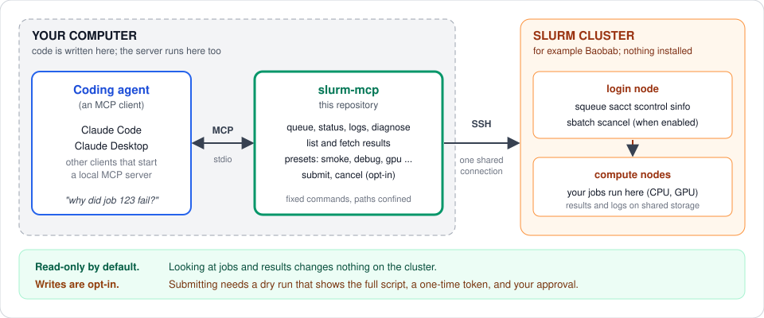

# slurm-mcp

An MCP server that lets a coding agent inspect and, with your approval, run jobs on a Slurm cluster over SSH.

## In 30 seconds



- **What it is.** A narrow, safe window onto your cluster for a coding agent. Write code on your laptop, then ask "why did job 123 fail?" or "run this on the debug preset" without pasting terminal output.
- **Where it runs.** On your computer, next to the agent, which starts it and talks to it over MCP (stdio). It reaches the cluster through one shared SSH connection. Nothing is installed on the cluster and no password is stored.
- **Which agents.** Used with Claude Code and Claude Desktop. Other MCP clients that can launch a local stdio server should work but are untested.
- **Safety.** Read-only by default. Submit and cancel are off until you enable them, then need a dry run showing the full script, a one-time token and your approval.

I built this mainly for my lab, the Kruse group at the University of Geneva. We run simulations on the UNIGE Baobab cluster and most of us write code with a coding agent. The agent could not see the cluster, so we pasted `squeue` output and logs into the chat. Each person runs the server on their own machine with their own SSH key and config. The design follows the SSH layer of [CommonUI](https://github.com/Lu-Dumoulin/CommonUI), a Julia tool for running and downloading parameter sweeps: one shared SSH connection, and incremental downloads that compare modification times.

**Status.** Covered by offline tests. Run on Baobab so far: the read-only tools, `slurm-mcp doctor --smoke` (a real job from the `smoke` preset, followed to the end), and cancelling a pending job. Upload, sweeps from a table, delete, hold and the other newer tools have offline tests only.

## Install

Python 3.11 or newer, `mcp` 2.x. On macOS or Linux, from the cloned folder:

```bash
./install.sh
```

It creates a virtual environment, installs the package, links `slurm-mcp` into `~/.local/bin` (which must be on your `PATH`), and runs `slurm-mcp init`. On Windows use `install.bat`.

`init` asks for the login host and username, then offers to test the connection (this also opens the shared SSH connection on macOS and Linux). If it works, it proposes your home directory as the default for `remote_roots` and offers directory symlinks found there (on many clusters `~/scratch` is one) as extra roots, shown by real path. It also asks for `local_dir` and an optional default parameter table, validates the answers and writes `~/.config/slurm-mcp/config.toml`. It never overwrites an existing config without asking.

By hand:

```bash
python -m venv .venv && . .venv/bin/activate
pip install -e ".[dev]"
slurm-mcp init          # or copy config.example.toml to ~/.config/slurm-mcp/config.toml
```

The config path can also be set with `SLURM_MCP_CONFIG` or `--config`. Optional switches (see `config.example.toml`): `enable_writes` (default `false`) exposes submit, cancel and upload, `local_roots` adds local folders that upload may read from, besides the agent's working folder, and `auto_connect` (default `true`, see below).

### Register with your agent

Claude Code:

```bash
claude mcp add slurm -- /path/to/slurm-mcp/.venv/bin/slurm-mcp
```

Claude Desktop, in `claude_desktop_config.json`:

```json
{
  "mcpServers": {
    "slurm": {
      "command": "/path/to/slurm-mcp/.venv/bin/slurm-mcp",
      "args": ["--config", "/Users/you/.config/slurm-mcp/config.toml"]
    }
  }
}
```

### Keep the agent on slurm-mcp

The idea is that the agent talks to the cluster only through these tools, so every action goes through the checks, dry runs and confirmations above. The server tells the agent this in its instructions, and `cluster_info` and `check_setup` exist so it does not need a raw `sinfo` or `ssh` to look around. If a tool is missing, the agent should say so rather than work around it.

To enforce it in Claude Code, deny the transfer commands in `.claude/settings.json` (one project) or `~/.claude/settings.json` (all projects):

```json
{
  "permissions": {
    "deny": ["Bash(ssh *)", "Bash(scp *)", "Bash(rsync *)", "Bash(sftp *)"]
  }
}
```

This is the current Claude Code rule syntax (`Bash(ssh:*)` is an equivalent older spelling). It is per agent: other agents have their own permission settings. slurm-mcp itself still uses `ssh` and `scp`, which is fine because it runs outside the agent's Bash tool. Limits to know: a deny rule does not match the same program called by its full path or inside `sh -c`, so for a hard guarantee also restrict network access in the agent's sandbox. To make the client prompt for every change, and for edits of the configuration, add `ask` rules. Rules are checked deny, then ask, then allow, and an ask rule prompts even when an allow rule also matches:

```json
{
  "permissions": {
    "ask": [
      "mcp__slurm__submit_job", "mcp__slurm__upload_code", "mcp__slurm__delete",
      "mcp__slurm__cancel_job", "mcp__slurm__cancel_jobs", "mcp__slurm__hold_job", "mcp__slurm__release_job",
      "Edit(~/.config/slurm-mcp/**)",
      "Edit(~/Library/Application Support/Claude/claude_desktop_config.json)"
    ]
  }
}
```

`Edit(...)` rules cover Claude's own edit and write tools but not a shell redirect such as `echo >> file`, so combine them with the Bash deny rules above or the sandbox. In auto mode a classifier approves instead of you, so keep the `ask` rules there too. You can also add a line to your project's `CLAUDE.md` or `AGENTS.md`: "Use the slurm MCP tools for everything on the cluster; never run ssh, scp or rsync yourself."

### Shared SSH connection

Clusters often throttle logins, so all calls share one OpenSSH `ControlMaster` connection (`ControlPersist`, default 10 minutes). macOS and Linux only; Windows OpenSSH has no multiplexing.

With `auto_connect = true`, a call that finds no open connection opens one without a prompt. This works when your key is available non-interactively (an unlocked key, `ssh-agent`, or the macOS keychain with `UseKeychain yes`). If a passphrase, password or second factor is needed, the call fails with a message to run `slurm-mcp login`, which the model cannot do for you. With `auto_connect = false` the server only uses a connection you opened yourself.

To open it manually, run this in a terminal on your own computer (not inside the agent, not on the cluster), from any folder:

```bash
slurm-mcp login      # asks for password or passphrase, then returns the prompt
slurm-mcp check      # is the connection alive?
```

If the command is not on your `PATH`, use `/path/to/slurm-mcp/.venv/bin/slurm-mcp`.

### Check that it works

```bash
slurm-mcp doctor
```

Read-only. Checks the config, the SSH connection (no prompt), `squeue`, that each root and each preset partition exists, that the GPU types exist on the GPU presets' partitions, and where generated scripts go. Each line is `OK`, `WARN` or `FAIL` with the reason.

```bash
slurm-mcp doctor --smoke
```

Also runs a real tiny job. It prints the full `smoke` preset script (15 minutes on `debug-cpu`, command `hostname; date; echo smoke-ok`) and asks you to type `y` before submitting. It then follows the job, prints the diagnosis and output, and reports pass or fail. `--preset debug` tests another preset. After 5 minutes in the queue it stops waiting and prints the job id; the job stays queued.

## Example session

Recorded on Baobab, 22 November 2026 (the smoke test of this project). Output is shortened, and the username in paths is replaced by `<user>`; `<u>` is the first letter of `<user>` (Baobab home folders are `/home/users/<u>/<user>`).

> **You:** Run a smoke test on Baobab.
>
> **Claude** calls `list_presets`, then `submit_preset_dry_run(preset="smoke", gpu=false, command=["bash", "-c", "hostname; date; echo smoke-ok"], workdir="/home/users/<u>/<user>/slurm-mcp-jobs", job_name="slurm-mcp-smoke")`. Nothing is submitted yet. It shows you the summary, the full script and the command:
>
> ```
> 1 task(s), 1 CPU(s) each, up to 00:15:00 each, 2G each, partition debug-cpu, GPU: no
>
> #!/bin/bash
> #SBATCH --job-name=slurm-mcp-smoke
> #SBATCH --partition=debug-cpu
> #SBATCH --time=00:15:00
> #SBATCH --cpus-per-task=1
> #SBATCH --mem=2G
> #SBATCH --output=%x-%j.out
>
> cd /home/users/<u>/<user>/slurm-mcp-jobs || exit 1
> srun bash -c 'hostname; date; echo smoke-ok'
> ```
>
> **You:** yes
>
> **Claude** calls `submit_job` with the token from the dry run: job 14501969 is submitted. Then `diagnose_job("14501969")`. A few seconds later the job is done:
>
> ```
> state: COMPLETED
> completed with exit code 0
> memory was over-requested: peak 6 MB of 2048 MB; you could ask for less
> stdout: cpu001.baobab
>         Sun Nov 22 01:32:41 PM CET 2026
>         smoke-ok
> stderr: merged into the stdout log (no separate --error file)
> ```

## Tools

| Tool | What it does | Writes |
|---|---|---|
| `check_setup` | The checks of `slurm-mcp doctor` (config, connection, roots, presets, upload folders), without the smoke test | nothing |
| `cluster_info` | Partitions with time limits, nodes, CPUs, memory and GPUs, plus Slurm limits such as `MaxArraySize` | nothing |
| `queue` | Your pending and running jobs (`squeue --me`) | nothing |
| `recent_jobs(days)` | Your jobs from the last 1 to 30 days (`sacct`) | nothing |
| `job_status(job_id)` | `sacct` rows plus whitelisted `scontrol` fields | nothing |
| `job_log(job_id, stream, lines)` | Tail of a job's stdout or stderr | nothing |
| `diagnose_job(job_id)` | Verdict (timeout, out of memory, exit code, pending reason, memory used versus requested) plus the end of stderr and stdout | nothing |
| `read_file(path, start_line, max_lines)` | A range of lines of a text file under a root (up to 1000 lines) | nothing |
| `grep_file(path, pattern, regex, ignore_case, context, max_matches)` | Search one text file: fixed string by default, optional regex | nothing |
| `storage_info(path)` | Free and used space of the roots (`df`), the size of a folder (`du`, with a time limit), and the configured quota commands (Baobab: home and scratch quota, parsed) | nothing |
| `tail_file(path, lines)` | Tail of a file under a configured root | nothing |
| `list_files(directory, max_depth, pattern)` | Files and subdirectories with type, size and mtime | nothing |
| `read_parameter_table(path)` | A CSV such as `sim/DF.csv`, as rows | nothing |
| `fetch_results(directory, pattern, dry_run)` | Copies missing or newer files locally | local disk only |
| `list_presets` | Presets, defaults, caps, GPU types on offer | nothing |
| `submit_preset_dry_run(preset, gpu, command, ...)` | Generates the full sbatch script from a preset, with cost summary and token | nothing |
| `upload_code_dry_run(remote_dir, local_path)` | Shows which local files would be copied to the cluster (new or changed ones), the large files, warnings, and a token | nothing |
| `upload_code(confirmation_token, confirm_large_files, verify)` | Copies those files; existing files with the same path are overwritten, nothing is deleted | writes files |
| `compare_code(remote_dir, local_path)` | Compares a local folder with a cluster folder (sizes, as in CommonUI) | nothing |
| `submit_job_dry_run(script_path)` | Same for a script already on the cluster | nothing |
| `submit_job(confirmation_token)` | Writes the reviewed script if there is one, then runs `sbatch` | submits a job |
| `cancel_jobs_dry_run(job_ids, name, state, all_mine)` | Selects several of your own jobs (one selector) and lists every match, with a token tied to that list | nothing |
| `cancel_jobs(confirmation_token)` | Cancels exactly those jobs | cancels jobs |
| `hold_job_dry_run(job_id)`, `release_job_dry_run(job_id)` | Show the pending job that would be held, or the job you held that would be released | nothing |
| `hold_job(confirmation_token)`, `release_job(confirmation_token)` | `scontrol hold` or `scontrol release` | changes job state |
| `delete_dry_run(path)` | What a recursive delete would remove: counts, size, largest files, with a token tied to that content | nothing |
| `delete(confirmation_token)` | Deletes it (cannot be undone) | deletes files |
| `cancel_job_dry_run(job_id)` | Shows which of your active jobs `scancel` would hit, and a token | nothing |
| `cancel_job(confirmation_token)` | Runs the command from that dry run | cancels jobs |

The write tools (job submission and its presets, cancel, cancel several, hold and release, delete, and the two upload tools) exist only when `enable_writes = true`. Each of them takes the token **and** a `review_text` argument, see "The approval prompt shows the plan" below. The upload tools and `compare_code` also need an allowed local folder (see Code upload). Without it the server exposes the read-only tools and `fetch_results`.

## Safety model

- **No shell access.** Each tool maps to a fixed command template (`squeue`, `sacct`, `scontrol show job`, `tail`, `find`, `head`, `scp`). Arguments are shell-quoted. Job ids must be `digits` or `digits_arrayindex`.
- **Path confinement.** Remote paths must be absolute, use a conservative character set (no spaces, globs, quotes, `~` or `..`) and lie inside a configured `remote_root`. This includes log paths that Slurm reports. Symlinks on the cluster are not resolved, so a symlink inside a root that points outside it would be followed: keep roots free of such links.
- **Bounded output.** Tail length, listing size, table size and download volume are capped by config.
- **Local writes are confined.** `fetch_results` writes below `local_dir`, mirrors the remote path, uses a `.part` file first, and refuses downloads above `max_download_mb`. Use `dry_run=true` to preview.
- **Tool annotations.** Every tool declares `readOnlyHint`, so clients can skip prompts for the read-only ones. `submit_job` and `cancel_job` are not read-only and `cancel_job` is destructive, so clients ask you first.
- **Writes are off by default.** Submit and cancel are not registered without `enable_writes = true`, and the cluster-facing code refuses them too.
- **The approval prompt shows the plan.** A token alone would show you `confirmation_token: xyz` in your client's approval prompt. So every dry run also returns a `review_text` (the exact command and the full script, file list, job list or entries), and each write tool must be called with that text unchanged. The server refuses the call if it differs from the stored plan, which keeps the token valid, and since clients show tool arguments in the prompt, you see what is about to happen there. Lists are capped at 300 lines with a count of the rest, and the plan hash covers everything. `submit_job`, `hold_job` and `release_job` are annotated destructive like the others.
- **Secrets are not readable.** `read_file`, `grep_file`, `tail_file`, `job_log`, `read_parameter_table`, `list_files` and `fetch_results` refuse paths that look like secrets (`.ssh`, `.gnupg`, `.aws`, `.netrc`, `.env*`, `id_rsa*` and other keys, `*.pem`, `*.key`, `credentials*`, `secrets*`, shell and REPL histories, keychains ...) by any path component, list them nowhere, and resolve the path on the cluster first, so a symlink cannot lead to one. Add patterns with `sensitive_extra`. Keep your roots as narrow as you reasonably can.
- **Protect the configuration.** `enable_writes`, the roots and the presets live in `~/.config/slurm-mcp/config.toml`, which an agent could edit with its ordinary file tools. The server refuses `/`, top-level folders and system folders as roots, and tells the agent to propose any config change first, with a warning about what it widens and a diff. To make the client enforce this, see the `ask` rules below.
- **Queue warning and ceiling.** Big parameter scans are normal, so nothing is refused below `max_queued_jobs` (default 10000, array tasks counted). A dry run that would bring your queued jobs above `warn_queued_jobs` (default 1000) adds a clear warning, in the dry-run result and at the top of `review_text` so it appears in the approval prompt: "LARGE SUBMISSION: this adds N job(s) or tasks; you would have M jobs queued (you have K now; warning threshold 1000, hard limit 10000)". Above the hard limit the dry run is refused.
- **`fetch_results` looks first.** `dry_run` defaults to true. Real downloads never replace a local file that is newer, and refuse a download folder that resolves outside `local_dir`.
- **Two steps with a token.** A dry run stores the exact remote command and returns a random single-use token that expires (default 5 minutes). The real call takes only the token, so what runs is what was shown. Tokens live in memory; restarting the server invalidates them.
- **Narrow write scope.** Submission is `sbatch --parsable` of one regular file inside a root (existing, or generated from a preset), run from its directory or the job's working directory, with no extra options. Cancellation is `scancel` of a validated job id that is in your own `squeue --me`. Cancelling a plain id cancels a whole array; use `123_4` for one task. No other command can be passed.
- **What the token does not prove.** It proves the executed command equals the reviewed one, not that a person approved it: a model could call both steps in a row. The human check is your client's approval prompt, so do not set `submit_job` or `cancel_job` to always-allow. A script that already exists on the cluster is only previewed (first 2000 bytes).
- **Deleting is the most guarded write.** `delete` works only strictly inside `remote_roots`: never a root, anything above one, or a folder that contains one, never inside `.ssh` or `.gnupg`, and never through a symbolic link (the path is resolved on the cluster and must equal the path given). The dry run lists counts, size and the largest files, the token is tied to that exact content, and the delete is refused if anything changed in between.
- **Cancelling several jobs** only ever lists jobs from `squeue --me` and runs `scancel` with explicit job ids (never `-u`). The token is tied to the listed jobs.
- **Uploads are confined on both sides.** See "Code upload": a local allowlist, secrets excluded by name, a destination checked by real path, confirmation for large files, and an overwrite warning in the dry run.
- **No credentials in the repo or config.** Authentication is your normal `~/.ssh` setup. `ssh` runs with `BatchMode=yes`, so it never waits at a password prompt.

## Generated jobs and presets

Typical use: write code on your laptop with an agent, ask for a quick test on the cluster, read why it failed, fix it, run the real job. The agent does not write arbitrary batch files. It picks a **preset** from your config and the server renders the script, as CommonUI does.

A preset fixes partition, time, CPUs, memory and (for GPU presets) the number of GPUs, with **hard caps** (`max_time`, `max_cpus`, `max_mem`, `max_gpus`; GPU presets use `max_cpus_per_gpu` instead of `max_cpus`, so 2 GPUs allow twice the CPUs). Overrides are refused above a cap. `config.example.toml` has five Baobab presets, checked with read-only `sinfo`: `smoke` (15 min on `debug-cpu`, fastest start), `debug` (30 min on `public-short-cpu`), `standard`, `gpu_debug` (30 min on `shared-gpu`; Baobab has no debug GPU partition) and `gpu`. The GPU list, partition list, 12 h default time, 3000 MB default memory and `%40` array throttle come from the CommonUI notebook. CommonUI preselects A100-40Gb and H100; the example preselects all three types. The example presets use the lab's own partition (`private-kruse-gpu`), so on another cluster adapt the partitions, time limits and GPU types to yours.

- **GPU is never assumed.** `gpu` is a required parameter with no default, and the tool description tells the agent to ask you. If you want a GPU it asks which type from your configured list. The dry run echoes the choice, for example `GPU: yes, 1 x A100-40Gb|H100`.
- **GPU availability is checked.** The dry run asks `sinfo` which node features each chosen partition has. With a list such as `private-kruse-gpu,shared-gpu` and an OR constraint, a type missing on one partition only gives a warning (for example "A100-80Gb is not available on private-kruse-gpu"), because Slurm uses whichever partition has a matching node. If no chosen partition has any chosen type, the job could never start and the dry run refuses.
- **The command is free-form but quoted.** A list of arguments, for example `["julia", "--optimize=3", "main.jl"]`, written as one quoted `srun` line, never a shell string. `{task_id}` in an argument becomes the array task id.
- **Everything else is validated.** Job name, partition, time, memory, array spec, module names and GPU types must match strict patterns or the config's lists, so nothing can add an `#SBATCH` line or a second command. Arrays are limited to `max_array_size` tasks (default 10000, Baobab's Slurm limit, so indices must be below it) and always get a `%N` concurrency limit.
- **You review the whole script.** The dry run returns the script text, its SHA-256, a cost summary (tasks, CPUs, time, memory, partition, GPU) and the sbatch command. The token is tied to that exact script: `submit_job` writes those bytes to `jobs_dir` and runs sbatch on them.

Limit: a job that runs your code is code on the cluster, whatever the wrapper. The controls are your review of the full script, the resource caps, the working directory confined to your roots, and the client's approval prompt on `submit_job`. Code reaches the cluster with `upload_code` (below), or with git or rsync.

### Parameter sweeps from a table

For runs like ActiveDewetting, where task N of a job array reads row N of a `DF.csv`, `submit_preset_dry_run` takes three optional arguments:

- `array_from_table`: path of a CSV on the cluster. The array becomes `1-N`, one task per data row (the header is not counted). The row count comes from one fixed `awk` call, and the array limit and index rule apply.
- `env`: variables to export, for example `{"path_to_data": "/srv/.../Data/proj/{task_id}/"}`. Names are validated (no `PATH`, `LD_*`, `HOME`, `SLURM_*` and similar), values are quoted, and `{task_id}` becomes the array task id.
- `task_dir`: a folder template such as `/srv/.../Data/proj/{task_id}`, inside your roots. Each task creates it with `mkdir -p` and enters it before running the command.

Presets can carry default `modules` and `env`. The `julia_sim` preset in `config.example.toml` does this (`module load Julia`, `use_gpu=true`), and with `command=["julia", "--optimize=3", "<code>/main.jl"]` the generated script matches what the CommonUI notebook writes for ActiveDewetting. The dry run shows the full script as always.

### Extra sbatch options

Both submit dry runs accept a short whitelist: `dependency` (`afterok:123`, `afterany:1:2`, `singleton`, ...), `qos`, `exclusive`, `hold` (submit held) and `mail_type`. `qos` is limited to `allowed_qos` (per preset, and in the config for existing scripts), `exclusive` needs `allow_exclusive`, and mail goes only to `mail_user` in the config, never to an address given by the agent. Everything is validated before it reaches the script or the command line.

## Code upload

`upload_code_dry_run(remote_dir, local_path=None)` then `upload_code(token)`, like the CommonUI notebook (which copies a local `sim/` folder into `~/Code/<project>/` with `scp`, no excludes and no deletion), with a review step added. The contents of a folder go into `remote_dir` (a single file goes in as `remote_dir/<name>`), and the destination is created if needed.

- **Which local folder.** By default the folder the agent works in: the folder the server was started in, and `local_path` defaults to it. Claude Desktop starts MCP servers in `/` (checked on a running install), which is refused, so there you list the folders in `local_roots` in the config. For Claude Code I could not check the starting folder from here: it is meant to be the project folder, and the server also honours `CLAUDE_PROJECT_DIR` if a client sets it. Too broad a folder is never used: `/`, your home folder or above, system folders, and general folders such as `~/Documents` or `~/Downloads`. The dry run says which rule allowed the source (`allowed_because`), and `slurm-mcp doctor` lists the folders. `upload_from_cwd = false` turns the default off.
- **Destination.** Must be inside `remote_roots`, and is resolved on the cluster with `realpath`, so a symlink there cannot lead out of the roots.
- **Incremental, no deletion.** Only files that are missing or newer are sent, so a second upload of the same code sends nothing. Remote files are never deleted (CommonUI does not delete either). Files that would be replaced are listed as overwrites, with a warning if the remote copy is newer.
- **Large files.** There is no size limit, because folders may hold initial conditions. Files above `large_file_mb` (default 10) are listed with their sizes in the dry run, and `upload_code` refuses until it is called with `confirm_large_files` naming exactly those paths. The token stays valid, so the agent asks you and calls again.
- **Never sent.** `.git`, virtual environments, `__pycache__`, `.env` files, SSH and cloud keys, `*.pem`, `*.key`, and the output folders `out`, `output`, `outputs` and `results`. `data` folders are sent. Symlinks and files with spaces or unusual characters in their names are skipped. Add patterns with `upload_exclude`. There is only a sanity limit on the number of files (`max_upload_files`, 5000).
- **No partial files.** Each file is copied to a temporary name (`.<name>.slurm-mcp-part`) next to its destination and renamed into place only after it arrived, so a failed copy leaves the old file intact. A failed file is reported, its temporary file is removed (the only remote deletion this server does), and the others continue.
- **Reviewed means sent.** The token is tied to the exact file list (see `plan_sha256`). If a local file changes after the dry run, nothing is uploaded.
- **Transport.** One `scp -p` per file over the shared connection, so modification times are kept. No `rsync`, as in CommonUI, for portability (macOS ships a limited `openrsync`).

Checking that the two sides match, like CommonUI's check: `compare_code(remote_dir, local_path=None)` is read-only and lists files only local, only on the cluster, with a different size, newer on one side (same size), and how many match. As in CommonUI, sizes decide; modification times only label same-size files. Files that exist only on the cluster do not count against "identical". `upload_code(..., verify=true)` runs the same size check on the uploaded files right after the upload. It is off by default.

## Tests

```bash
pip install -e ".[dev]"   # once, installs pytest
pytest -q
```

No test needs a cluster or SSH keys. The SSH layer sits behind a `Runner` interface; tests use a scripted `FakeRunner` (`tests/fakes.py`) and, for one end-to-end test, a stub `ssh` that the real server process calls over MCP stdio. Parsing, path validation, sync planning, script generation and diagnosis are pure functions with their own tests, including golden tests of the generated scripts. CI runs Python 3.11 to 3.13.

Not covered: a real Slurm installation. `squeue`, `sacct` and `scontrol` formats differ slightly between Slurm versions, and `find -printf` needs GNU find on the cluster. Check against your own cluster before relying on it.

## Layout

```
src/slurm_mcp/
  config.py    TOML config, validated
  paths.py     remote path validation
  runner.py    Runner protocol and subprocess implementation
  commands.py  pure ssh/scp argument vectors and fixed remote commands
  parsing.py   pure parsers for squeue, sacct, scontrol, sinfo, find
  sync.py      pure incremental download planning (also used for uploads)
  uploads.py   local scan, exclusions and allowlist for code upload
  presets.py   presets, caps and unit parsing
  jobscript.py pure sbatch script generation
  diagnose.py  pure reading of job accounting data
  doctor.py    setup check and smoke test (slurm-mcp doctor)
  confirm.py   single-use confirmation tokens
  cluster.py   cluster operations (read-only, plus submit and cancel when enabled)
  server.py    MCP tool definitions
  setup.py     interactive config creation (init)
  __main__.py  serve, login, check, init, doctor
tests/
docs/overview.svg
```

## Acknowledgements

The code, tests and documentation were written by Claude (Anthropic), an AI assistant, under the author's instruction. The author chose the scope and the safety rules, directed the work step by step and tested it on the Baobab cluster.

## License

MIT.
